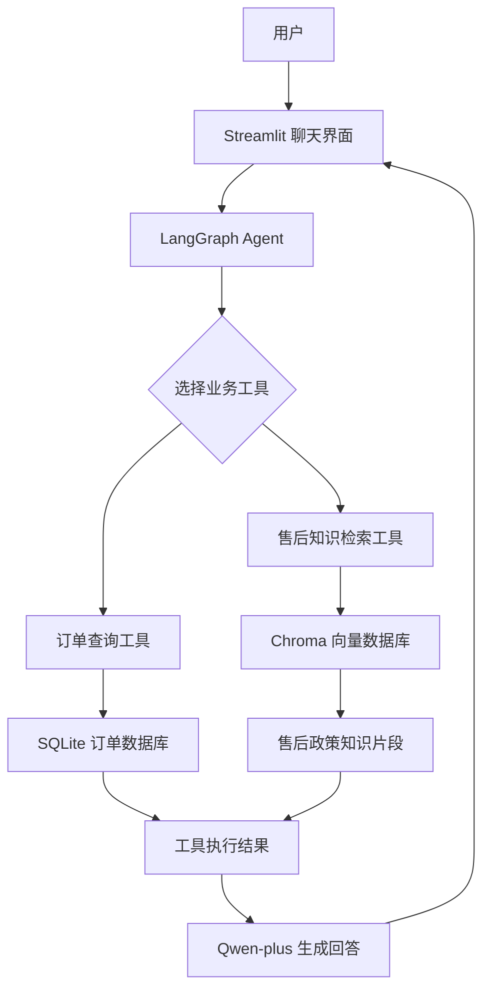

# 🛍️ E-Commerce Care Agent｜电商智能客服 Agent

基于 **通义千问（Qwen）+ LangGraph + Chroma + SQLite + Streamlit** 构建的电商智能客服 Agent 原型。

项目模拟电商平台售前售后客服场景，支持自然语言对话、订单信息查询、售后政策知识检索，并通过 Agent 工具调用完成问题处理。

> 本项目为个人独立开发的学习与演示项目，使用模拟订单数据，不连接真实电商平台。

---

## 一、项目介绍

传统客服系统通常依赖固定关键词和预设规则，面对复杂问题时灵活性不足。

本项目尝试使用大语言模型与 Agent 工作流，让智能客服能够理解用户意图，并根据问题选择合适的工具：

- 用户询问订单状态时，调用订单查询工具。
- 用户询问退货、退款、换货等政策时，调用知识库检索工具。
- 用户同时询问订单和售后问题时，结合订单数据与政策知识生成回答。
- 对于知识库中没有明确说明的政策，不随意承诺处理结果。

项目重点是实践 **LLM、Agent 工具调用、RAG 知识检索和多轮对话** 的完整开发流程。

## 二、核心功能

| 功能模块 | 功能说明 |
|---|---|
| 智能客服对话 | 使用通义千问理解用户自然语言问题 |
| Agent 工具调用 | 使用 LangGraph Agent 调用不同业务工具 |
| 订单查询 | 查询模拟订单状态、商品和物流信息 |
| 售后知识检索 | 使用 Chroma 检索售后政策知识片段 |
| RAG 问答 | 结合检索结果生成售后政策回答 |
| 多轮对话 | 在 Streamlit 界面中进行连续对话 |
| 安全回答 | 对未确认的政策和处理结果保持谨慎，不随意承诺 |

## 三、技术栈

| 技术 | 用途 |
|---|---|
| Python | 后端开发语言 |
| Streamlit | Web 聊天交互界面 |
| Alibaba Cloud Bailian | 大语言模型与 Embedding 服务 |
| Qwen-plus | 客服对话模型 |
| LangGraph / LangChain | Agent 工作流与工具调用 |
| ChromaDB | 向量数据库 |
| text-embedding-v3 | 文本向量化 |
| SQLite | 模拟订单数据存储 |
| python-dotenv | 环境变量管理 |

## 四、系统架构



## 五、项目目录

```text
ecomcare-agent/
│
├── app.py                  # Streamlit 聊天应用入口
├── agent_graph.py          # LangGraph Agent 核心逻辑
├── order_tools.py          # 订单查询工具
├── vector_tools.py         # Chroma 知识检索工具
├── build_vector_db.py      # 构建向量知识库
├── test_knowledge.py       # 知识库检索测试
│
├── knowledge/              # 售后政策知识文件
│   ├── after_sales.txt
│   ├── return_policy.txt
│   ├── refund_policy.txt
│   ├── exchange_policy.txt
│   ├── quality_policy.txt
│   ├── shipping_policy.txt
│   └── human_service.txt
│
├── chroma_db/              # 本地生成的向量数据库
├── orders.db               # 本地模拟订单数据库
├── .env                    # 本地环境变量，不提交到 GitHub
├── .env.example            # 环境变量配置示例
├── .gitignore
└── README.md
```

说明：`chroma_db/` 和 `orders.db` 为本地运行数据，按项目配置不需要提交到 GitHub。首次运行时需要根据项目脚本生成或初始化相应数据。

## 六、本地运行

### 1. 克隆项目

```bash
git clone https://github.com/dshrgliuea/ecomcare-agent.git
cd ecomcare-agent
```

### 2. 创建虚拟环境

```bash
python -m venv .venv
```

Windows PowerShell：

```powershell
.\.venv\Scripts\Activate.ps1
```

### 3. 安装依赖

如果项目中提供了 `requirements.txt`：

```bash
pip install -r requirements.txt
```

如果尚未提供依赖清单，需要根据项目实际导入的模块整理并安装依赖。

### 4. 配置环境变量

在项目根目录创建 `.env` 文件，配置百炼 API：

```env
DASHSCOPE_API_KEY=替换为你自己的API_KEY
DASHSCOPE_MODEL=qwen-plus
DASHSCOPE_BASE_URL=https://dashscope.aliyuncs.com/compatible-mode/v1
```

请使用自己的百炼 API Key。不要将真实密钥提交到 GitHub。

### 5. 构建向量知识库

```powershell
.\.venv\Scripts\python.exe build_vector_db.py
```

等待脚本完成知识片段读取、向量化和 Chroma 写入。

### 6. 启动应用

```powershell
.\.venv\Scripts\python.exe -m streamlit run app.py
```

浏览器打开：

```text
http://localhost:8501
```

## 七、演示场景

项目内置模拟订单，可用于测试客服对话。

| 订单编号 | 模拟状态 | 商品 |
|---|---|---|
| 10001 | 已发货 | 蓝色牛仔裤 |
| 10002 | 待发货 | 演示订单商品 |
| 10003 | 已签收 | 演示订单商品 |

可以尝试以下问题：

**订单查询**
- 帮我查询订单 10001 的物流状态。
- 我的订单什么时候发货？

**售后政策**
- 买了五天的衣服可以退货吗？
- 商品有质量问题应该怎么办？
- 不喜欢商品可以申请退货吗？

**组合问题**
- 我的牛仔裤已经发货了，如果收到后发现有破损怎么办？
- 不方便寄回商品，可以直接退款吗？

## 八、项目亮点

1. **Agent 工具调用**：通过 Agent 将自然语言问题与订单查询、知识检索工具连接起来。
2. **RAG 知识库**：将售后政策拆分为知识片段，通过向量检索获取相关内容。
3. **业务数据与知识分离**：订单状态来自 SQLite，政策信息来自知识库，减少模型凭空编造业务事实的风险。
4. **谨慎的客服回答策略**：对于尚未确认的退款、运费和人工服务政策，不直接承诺结果。
5. **可扩展的项目结构**：后续可以继续扩展工单系统、用户权限、真实订单 API 和部署能力。

## 九、当前项目边界

当前版本是一个可运行的个人开发原型：

- 订单数据为本地模拟数据。
- 售后政策为演示知识库内容。
- 不连接真实电商平台或物流平台。
- 不执行真实退款、退货或换货操作。
- 不包含生产环境所需的完整用户认证、权限管理和监控体系。
- 线上部署尚未纳入当前版本。

## 十、后续优化方向

- 接入真实电商订单 API。
- 增加 SQLite 工单创建与管理。
- 增加用户身份认证和角色权限。
- 优化 Agent 意图识别与工具调用策略。
- 增加自动化测试和异常监控。
- 部署到云服务器，实现公网访问。

## 十一、项目地址

GitHub：

https://github.com/dshrgliuea/ecomcare-agent

## 十二、开发总结

本项目从零搭建了一个电商智能客服 Agent 原型，实践了 Python 项目结构设计、LLM API 接入、LangGraph Agent、工具调用、RAG 知识检索、SQLite 数据查询以及 Streamlit Web 应用开发。

通过该项目，完成了从基础 AI 对话到具备业务工具调用能力的智能客服原型的开发实践。